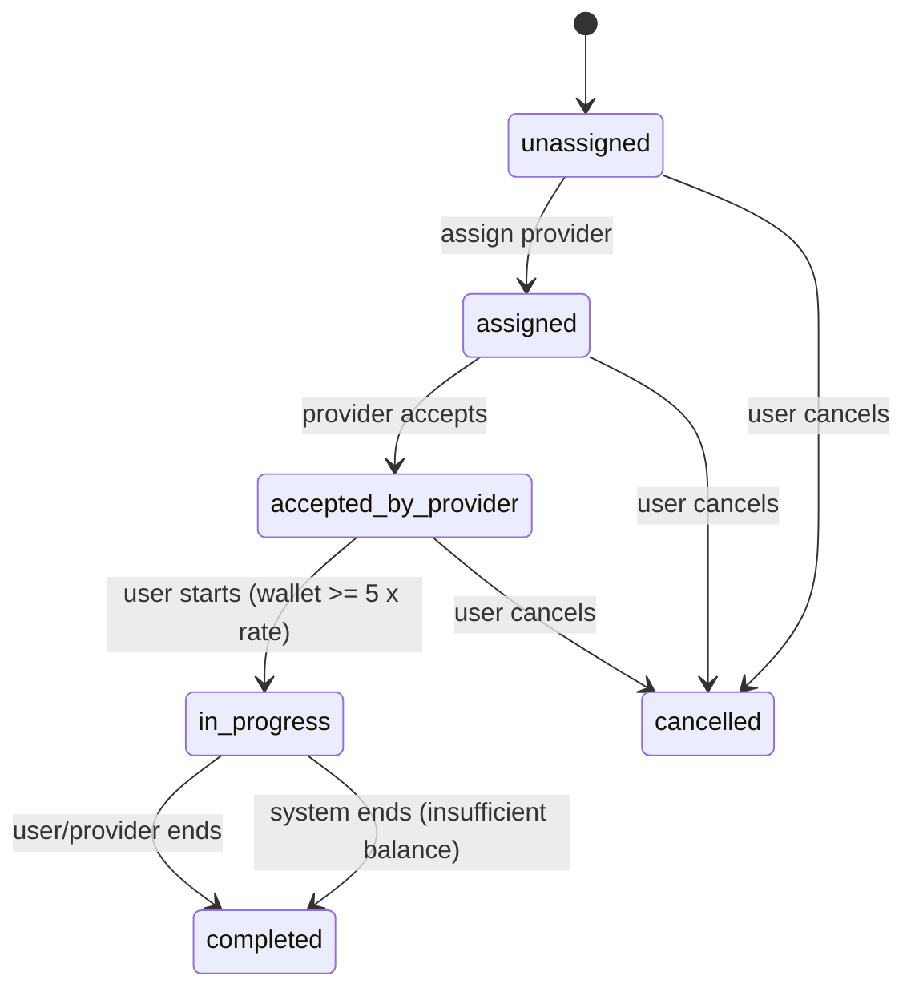
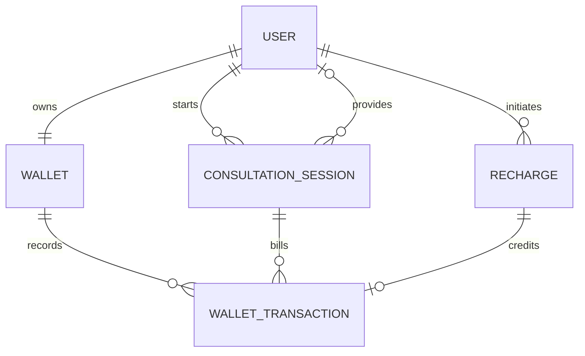

<<<<<<< HEAD
# Django Wallet-Based Per-Minute Session Billing

A Django REST Framework API for prepaid consultation sessions. This implementation follows the supplied assignment: wallet balance and mock recharge, provider assignment/acceptance, session state transitions, per-minute billing, automatic completion on insufficient funds, JWT authentication, and automated tests.

## Stack
- Python 3.11+ (recommended), Django 5.2 LTS, Django REST Framework
- Simple JWT authentication
- PostgreSQL in production; SQLite for local development
- Gunicorn + WhiteNoise for deployment

## 1. Setup (Windows PowerShell)
```powershell
py -m venv .venv
.\.venv\Scripts\Activate.ps1
python -m pip install --upgrade pip
pip install -r requirements.txt
Copy-Item .env.example .env
python manage.py makemigrations billing
python manage.py migrate
python manage.py createsuperuser
python manage.py runserver
```

If PowerShell blocks activation:
```powershell
Set-ExecutionPolicy -Scope Process -ExecutionPolicy Bypass
.\.venv\Scripts\Activate.ps1
```

## 2. Setup (Linux/macOS)
```bash
python3 -m venv .venv
source .venv/bin/activate
pip install -r requirements.txt
cp .env.example .env
python manage.py makemigrations billing
python manage.py migrate
python manage.py createsuperuser
python manage.py runserver
```

`settings.py` does not automatically load `.env`; export environment variables in your shell or use your deployment platform's environment configuration. Generate and commit the initial migration before deploying: `python manage.py makemigrations billing` then `python manage.py migrate`. SQLite is used when `DATABASE_URL` is unset. For production, set `DJANGO_SECRET_KEY`, `DJANGO_DEBUG=False`, `DJANGO_ALLOWED_HOSTS`, and `DATABASE_URL` to a PostgreSQL URL.

## 3. Tests
```bash
python manage.py test billing
```

## 4. Authentication and roles
Registration is open at `POST /api/auth/register/`. Roles are `USER` and `PROVIDER`. Public self-registration creates `USER` accounts only. Create `PROVIDER` accounts through Django admin or a trusted invitation/provisioning workflow. Obtain JWT:
```http
POST /api/auth/token/
Content-Type: application/json

{"username":"alice","password":"your-password"}
```
Send the returned access token as `Authorization: Bearer <access-token>`.

## 5. API endpoints

| Method | Endpoint | Purpose |
|---|---|---|
| GET | `/api/health/` | Health check |
| POST | `/api/auth/register/` | Register user |
| POST | `/api/auth/token/` | Obtain JWT pair |
| POST | `/api/auth/token/refresh/` | Refresh access token |
| GET | `/api/wallet/` | Current user's wallet |
| GET, POST | `/api/wallet/recharges/` | List own recharges / initiate mock recharge |
| POST | `/api/wallet/recharges/mock-callback/` | Mock payment callback |
| GET | `/api/wallet/transactions/` | Own wallet ledger |
| GET, POST | `/api/sessions/` | List own sessions / create session |
| GET | `/api/provider/sessions/` | Provider's assigned and unassigned sessions |
| GET | `/api/sessions/{uuid}/` | Session detail for its user/provider |
| POST | `/api/sessions/{uuid}/assign/` | User assigns a provider; body `{"provider_id": 2}` |
| POST | `/api/sessions/{uuid}/accept/` | Assigned provider accepts |
| POST | `/api/sessions/{uuid}/start/` | User starts accepted session |
| POST | `/api/sessions/{uuid}/bill/` | Trigger billing for elapsed whole minutes |
| POST | `/api/sessions/{uuid}/end/` | User/provider ends active session |
| POST | `/api/sessions/{uuid}/cancel/` | User cancels before start |

### Mock recharge flow
1. Authenticated `USER` calls `POST /api/wallet/recharges/` with `{"amount":"100.00"}`.
2. API returns a `reference` and `pending` status.
3. Simulate payment provider callback using `POST /api/wallet/recharges/mock-callback/` with `{"reference":"MOCK-...","status":"success"}`.
4. Replaying the same success callback does not credit the wallet twice. This callback is intentionally public for the assignment and MUST be authenticated/signature-verified before real production use.

### Session billing semantics
- A session requires a starting wallet balance of at least 5 × the per-minute rate.
- The session's rate is copied to `fixed_rate_per_minute` at start.
- Billing charges only completed whole minutes, and the unique `(session, minute_number)` ledger constraint protects against duplicate charges.
- Billing must be triggered periodically by calling the `bill` endpoint (or from a scheduled worker). A synchronous billing mechanism is used per the assignment.
- If the wallet cannot cover the next full minute, the session is completed with `ended_by=system` and `end_reason="Insufficient balance for next minute"`; no negative balance or partial-minute charge is made. `billed_minutes` tracks paid minutes, while timestamps preserve the actual elapsed time.
- The user may have only one in-progress session. Database row locks are used around wallet/session updates; PostgreSQL is recommended for meaningful row-level concurrency guarantees. SQLite is suitable for local development/tests only.

## 6. State diagram


## 7. ER overview


## 8. Important implementation decisions
1. Wallet mutations are performed in database transactions and each recharge callback is idempotent.
2. The wallet ledger is append-only through the API; each session-minute charge has a database uniqueness constraint.
3. Money is stored as `Decimal`, not floating-point.
4. Session state changes are validated by service functions and invalid transitions return DRF `400` responses.
5. Billing rounds down to completed minutes and never charges a partial minute.
6. PostgreSQL is the production database. Configure secrets and host settings through environment variables. The mock callback, public provider-role registration, and synchronous billing are assignment-level choices, not safe final choices for a real money-handling deployment.
=======
# django-vallet-billing
this is the django vallet billingff
>>>>>>> 631a50b3148c6590a5337b83edcc3f46cdcb092c
